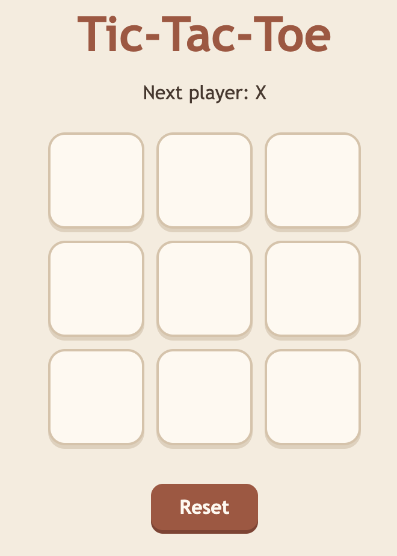
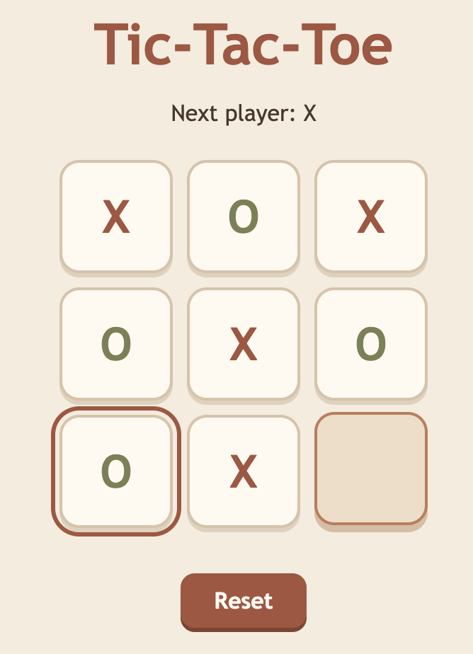

# 🎮 Tic-Tac-Toe

A simple Tic-Tac-Toe game built with React, TypeScript and Vite as a frontend development practice project.

## 📸 Screenshots

### Game board


### Gameplay


## ✨ Features

- Play Tic-Tac-Toe with two players, X and O
- Alternate turns automatically
- Detect winning combinations
- Detect a draw
- Reset the game at any time
- Responsive, warm autumn-inspired styling
- Hover and focus effects for interactive elements

## 🛠️ Built With

- React
- TypeScript
- Vite
- CSS

## 🚀 Getting Started

### Prerequisites

Make sure you have Node.js and npm installed.

### Installation

1. Clone the repository:

   ```bash
   git clone https://github.com/Marcusey/exercise-tictactoe.git
   ```

2. Navigate to the project folder:

   ```bash
   cd exercise-tictactoe
   ```

3. Install dependencies:

   ```bash
   npm install
   ```

4. Start the development server:

   ```bash
   npm run dev
   ```

5. Open the local URL shown in your terminal.

## 📚 What I Practiced

- Building reusable UI with React components
- Managing game state with `useState`
- Rendering lists with `map()` and using `key`
- Handling click events
- Using TypeScript types for game data
- Working with conditional rendering
- Styling components with CSS
- Using Git and GitHub to track development

## 👤 Author

**Marcus Yttermyr**

- GitHub: [@Marcusey](https://github.com/Marcusey)